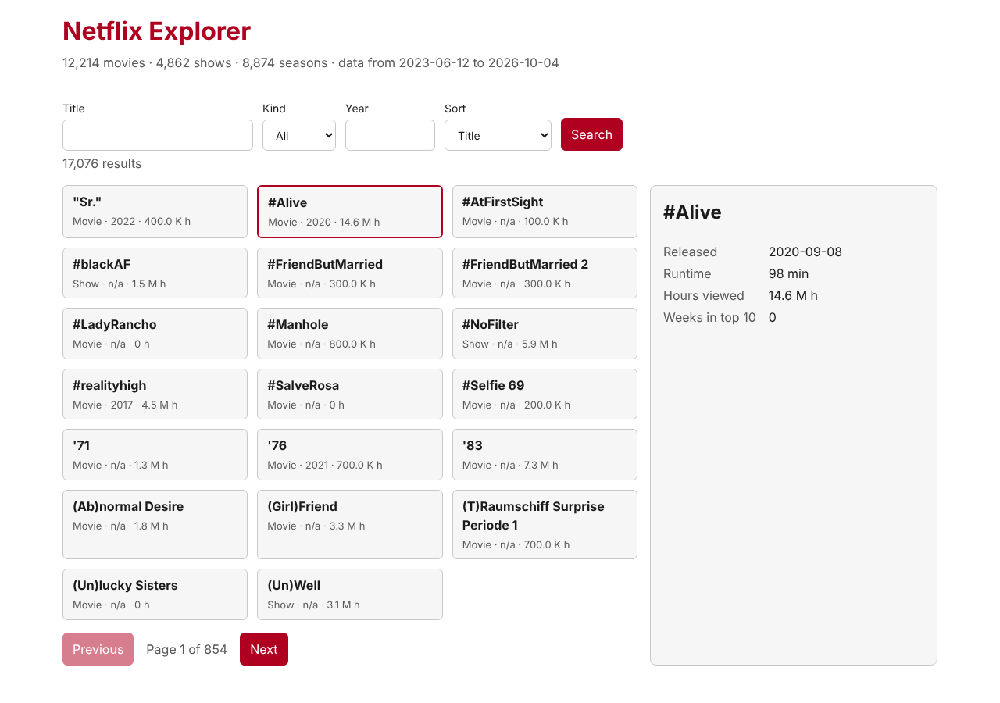

# Incidents: the agent without a harness

What happened when an agent built spec 01 with no rules at all (prompt: "Lee la spec 1 y empieza el proyecto. Es en TypeScript."). Each row is something a person saw, with its evidence. The code it left is on the `sin-harness` branch.

| # | What happened | Evidence | What would fix it |
|---|---|---|---|
| I1 | Nobody opened the app in a browser before saying it was done | The agent's own summary: "No he abierto la UI en un navegador, así que el aspecto visual, la accesibilidad y el ancho de 360 px están sin comprobar" | Tests that use the app in a real browser, and a rule that a UI change is not done until they pass |
| I2 | The test that should prove the catalog is read-only proves nothing | `catalog connection is read-only` opens its own read-only connection. With `openCatalog` changed to `readOnly: false` and `query_only` removed, all 7 tests still pass | Test the connection the app uses, and break the rule on purpose to see the test fail |
| I3 | "Weeks in the top 10" was defined by the agent on its own | It chose the max of `cumulative_weeks_in_top10`. Counting WEEKLY rows is the other option: 115 movies change (*Through My Window*: 18 or 5) | A written decision, with the reason, that every session reads |
| I4 | Other business definitions were also decided silently | Hours = SEMI_ANNUALLY rows only; show hours = sum of its seasons; text search = substring ("10 Cloverfield Lane" matches "love") | The same written decisions |
| I5 | The agent chose the structure | `src/server/` and `src/web/`, with SQL, HTTP and rules mixed in `catalog.ts` and `app.ts`. No layers | Written layers, and a test that fails when one imports what it must not |
| I6 | Old dependency versions, with `^` | `vite ^6` (6.4.5 installed, latest 8.3.5), `typescript ^5.6` (latest 7.0.2), `vitest ^3` (latest 5.1.0). It also added `tsx`, which Node 24 does not need to run TypeScript | Pinned versions written down |
| I7 | There is no single command that says "this is healthy" | `typecheck` and `test` are separate scripts, and the build is a third one | One verification command |
| I8 | No branch and no commit | Everything left uncommitted on the starting branch | Rules for branches and commits that something other than the agent enforces |
| I9 | Nothing stops anyone from reading the `BATCH_*` tables | Only a code comment says "never touches BATCH_*". The agent listed them while exploring; this time it did not read them | Something that blocks the read, not a comment |

## Looked for and not found this time

- The server did not crash on `/favicon.ico`, an unknown route, a malformed URL or bad parameters: it answered 404 or 400 and kept serving.
- Errors are visible: with the server stopped, clicking a title shows "Could not load detail."
- At 360 px there is no horizontal scroll.
